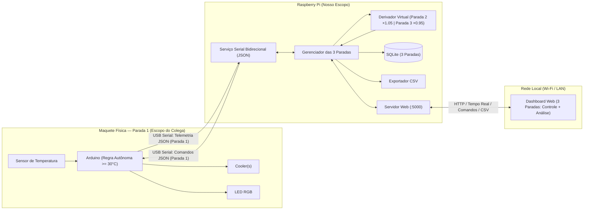

# PRD — Dashboard Central de Monitoramento e Controle de Paradas de Ônibus (Raspberry Pi)

**Demanda:** `abrigo-ventilacao-automatica`  
**Versão:** `1.3`  
**Status:** 🟡 Revisão Final (Atualizado com gráficos individuais por parada — aguardando aprovação formal)

---

## 1. Visão Geral e Contexto

### 1.1 Problema
As ondas de calor e temperaturas extremas estão cada vez mais frequentes nas cidades. Em grande parte dos pontos de ônibus, os abrigos consistem apenas em coberturas de metal ou acrílico que absorvem radiação solar e retêm calor. Como consequência, os usuários ficam expostos a desconforto térmico intenso, desidratação, mal-estar e, em casos graves, insolação.

### 1.2 Público Afetado e Usuários do Sistema
- **Beneficiários diretos da solução física:** Usuários do transporte público — em especial idosos, crianças, gestantes, pessoas com doenças crônicas e trabalhadores que permanecem longos períodos expostos ao calor por não possuírem alternativa de transporte.
- **Usuários do sistema Web (Raspberry Pi):**
  - **Apresentadores / Avaliadores da maquete:** Acessam o dashboard pelo navegador (celular, notebook ou tela local) na rede local para acompanhar e controlar uma rede simulada de **3 paradas de ônibus** em tempo real — sendo **1 parada real** (conectada à maquete via Arduino) e **2 paradas simuladas** derivadas dos dados reais — demonstrando o potencial de escala urbana da solução.
  - **Operadores / Analistas de dados:** Monitoram o estado das 3 paradas, atuam nos controles (desligar ventilação / alterar limite), acompanham gráficos comparativos e exportam os dados históricos em CSV para análise.

### 1.3 Objetivo do Produto
Desenvolver o software embarcado na **Raspberry Pi** responsável por se comunicar via **Serial (USB)** em formato **JSON** com o **Arduino autônomo** da maquete física (Parada 1), gerar automaticamente os dados simulados de outras **2 paradas virtuais** derivadas em tempo real da leitura física (ex.: aplicando fatores multiplicativos distintos como `× 1.05` e `× 0.95`), persistir todo o histórico em **SQLite**, permitir exportação em **CSV** e servir uma **dashboard Web de controle e análise** na rede local (`http://<IP-DA-RASPI>:5000`).

---

## 2. Divisão de Responsabilidades e Escopo

### 2.1 Arquitetura Funcional (Opção A — Arduino Autônomo + 2 Paradas Derivadas na Raspi)
- **Arduino (fora do nosso escopo de código — sob responsabilidade do colega):**
  - Representa a **Parada 1 (Real / Maquete)**.
  - Lê o sensor de temperatura instalado na maquete.
  - Executa localmente e de forma autônoma a regra de decisão (`se temperatura >= limite, liga a ventilação; senão, desliga`), com limite padrão inicial de **30 °C**.
  - Aciona o(s) cooler(s) e atualiza o LED RGB físico indicando o estado (`NORMAL` / `VENTILANDO`).
  - Envia continuamente a telemetria em **JSON por linha** pela porta Serial para a Raspberry Pi.
  - Recebe comandos em **JSON por linha** vindos da Raspberry Pi para alterar a temperatura limite ou desligar/alternar a ventilação (override manual / retorno ao modo automático).
- **Raspberry Pi (nosso escopo):**
  - Escuta continuamente a porta Serial do Arduino (Parada 1) e envia comandos quando acionados no painel.
  - Calcula em tempo real os dados das **Paradas 2 e 3 (Virtuais / Derivadas)** a partir da temperatura recebida do Arduino (ex.: fator configurável como `temp * 1.05` para parada mais exposta ao sol e `temp * 0.95` para parada parcialmente sombreada), aplicando para cada parada virtual seu próprio limite, estado de ventilação e controles independentes.
  - Persiste leituras, transições de estado e comandos das **3 paradas** em banco **SQLite** local.
  - Disponibiliza exportação dos dados persistidos em **CSV** (todas as paradas ou filtrada por parada).
  - Expõe um servidor Web na rede local (`0.0.0.0:5000`, porta configurável) com a dashboard de monitoramento, controle e análise.

### 2.2 Dentro do Escopo (In-Scope)
- Serviço em Python (3.12+) rodando na Raspberry Pi para comunicação **Serial bidirecional** (JSON por linha) com a Parada 1 (Arduino).
- Motor de derivação para **2 paradas virtuais** alimentadas pelas leituras da Parada 1, com fatores de variação configuráveis (ex.: `× 1.05` e `× 0.95`), cada uma mantendo limite de temperatura, modo (`AUTOMÁTICO` / `MANUAL`) e estado de ventilação independentes.
- Documentação clara do contrato JSON Serial (Arduino ↔ Raspberry Pi) para integração com o colega.
- Persistência local em **SQLite** com identificação por parada (`parada_id`, `origem: REAL | SIMULADA`, temperatura, ventilação, limite, modo e timestamp).
- Exportação de dados em **CSV** (geral ou por parada) para análise de dados.
- Servidor Web acessível na rede local (`0.0.0.0:5000`, porta configurável).
- **Dashboard Web de Controle e Análise** contendo:
  - Visão geral consolidada das **3 paradas** (resumo da rede: temperatura média/máxima, quantas paradas estão ventilando, status da conexão Serial).
  - Cards individuais para cada uma das 3 paradas identificando claramente origem (**Real / Arduino** vs **Simulada**), temperatura atual (°C), estado (`NORMAL`, `VENTILANDO`, `SEM CONEXÃO`), paleta de cores (**Verde** = Normal, **Azul/Vermelho** = Ventilando, **Amarelo/Cinza** = Sem sinal), modo (`AUTOMÁTICO` / `MANUAL`), limite ativo (padrão inicial: **30 °C**) e **gráfico individual exibido por padrão** mostrando a variação da temperatura ao longo do tempo (com linha de referência do limite configurado).
  - Controles individuais por parada: **desligar ventilação** (override manual com opção de retornar ao modo automático) e **alterar temperatura limite**. Na Parada 1 o comando é enviado pela Serial ao Arduino; nas Paradas 2 e 3 o comando atua imediatamente no simulador derivado.
  - Painel analítico complementar: visão comparativa das 3 paradas, histórico recente de eventos/acionamentos e botão de **exportar CSV**.
- Modo **Simulador Completo (Sem Hardware)** para gerar leituras da própria Parada 1 (propagando para as Paradas 2 e 3) durante desenvolvimento, testes automatizados e demonstrações sem o Arduino conectado.

### 2.3 Fora do Escopo (Out-of-Scope)
- Desenvolvimento do firmware `.ino` (C/C++) do Arduino.
- Montagem elétrica/física da maquete (protoboard, jumpers, coolers, fonte externa, LED RGB e sensor).
- Exposição do sistema na Internet pública (HTTPS público, DNS, autenticação corporativa) — acesso restrito à rede local (LAN/Wi-Fi).

---

## 3. Requisitos Funcionais (RF)

| ID | Requisito | Prioridade |
| --- | --- | --- |
| **RF-01** | **Recepção Serial Contínua (JSON — Parada 1):** O sistema na Raspberry Pi deve ler continuamente linhas JSON enviadas pelo Arduino via porta Serial (ex.: `/dev/ttyACM0` ou `/dev/ttyUSB0`), configurável sem alterar código. | Alta |
| **RF-02** | **Validação de Telemetria:** O sistema deve validar e parsear cada mensagem JSON recebida (temperatura numérica, estado da ventilação, limite ativo e modo opcional), descartando linhas corrompidas sem interromper o serviço. | Alta |
| **RF-03** | **Simulação Derivada das Paradas 2 e 3:** A cada leitura válida recebida da Parada 1 (Arduino), o backend deve gerar automaticamente as leituras correspondentes para 2 paradas virtuais usando fatores configuráveis (ex.: `× 1.05` e `× 0.95`), avaliando individualmente a regra de ventilação (`temp >= limite`, respeitando override manual) de cada parada. | Alta |
| **RF-04** | **Controle Individual (Bidirecional na Parada 1 + Virtual nas Paradas 2 e 3):** O dashboard deve permitir, para qualquer uma das 3 paradas: (a) **desligar a ventilação** (override manual, com opção de voltar ao modo automático) e (b) **alterar a temperatura limite** (iniciando em `30 °C`). Para a Parada 1, o comando é enviado em JSON pela Serial ao Arduino; para as Paradas 2 e 3, é aplicado diretamente no estado interno da Raspi. | Alta |
| **RF-05** | **Dashboard Web Multi-Paradas em Tempo Real:** O sistema deve servir uma dashboard na porta `5000` (`0.0.0.0`), acessível via `http://<IP-DA-RASPI>:5000`, exibindo resumo geral, cards das 3 paradas (identificando `REAL` vs `SIMULADA`), paleta de estados, controles e **gráfico individual por padrão em cada parada** exibindo a variação da temperatura ao longo do tempo (com marcação do limite), tudo atualizado automaticamente sem refresh manual. | Alta |
| **RF-06** | **Persistência em SQLite Multi-Paradas:** O sistema deve gravar em banco SQLite local o histórico de leituras e eventos (acionamentos e comandos) das 3 paradas, preservando os dados após reinicializações. | Alta |
| **RF-07** | **Exportação em CSV para Análise:** O sistema deve permitir baixar um arquivo `.csv` estruturado (timestamp ISO-8601, `parada_id`, `nome`, `origem`, `temperatura`, `limite`, `ventilacao`, `modo`), com opção de exportar todas as paradas ou filtrar por uma parada específica. | Alta |
| **RF-08** | **Detecção de Perda de Sinal e Reconexão Automática:** Caso o Arduino desconecte ou pare de enviar dados acima do timeout configurado, o painel deve sinalizar `DESCONECTADO / SEM SINAL`, pausar a derivação de novas leituras virtuais (evitando dados falsos) e tentar reconectar automaticamente à porta Serial. | Alta |
| **RF-09** | **Modo Simulador Completo (Sem Hardware):** O sistema deve suportar execução sem Arduino conectado, gerando leituras simuladas para a Parada 1 (cruzando `30 °C`) que alimentam normalmente as Paradas 2 e 3, os comandos, o SQLite e a exportação CSV. | Média |

---

## 4. Requisitos Não Funcionais (RNF)

| ID | Categoria | Requisito |
| --- | --- | --- |
| **RNF-01** | **Desempenho / Hardware** | Deve operar com baixo consumo de CPU, memória e escritas em disco, adequado para execução contínua em uma Raspberry Pi (cartão SD). |
| **RNF-02** | **Latência de Atualização** | Leituras recebidas via Serial, cálculos das paradas derivadas e respostas a comandos devem refletir na dashboard Web em até 2 segundos. |
| **RNF-03** | **Resiliência** | Erros de cabo USB, ruído serial, JSON malformado ou reinicialização do Arduino não podem derrubar o servidor Web nem corromper o banco SQLite. |
| **RNF-04** | **Usabilidade / Responsividade** | A dashboard deve ser responsiva (desktop, tablet e celular na rede local) e oferecer boa legibilidade visual para apresentação da maquete. |
| **RNF-05** | **Qualidade de Código** | Backend implementado em **Python 3.12+**, com tipagem estrita (`type hints`), modelagem via `dataclasses`, separação clara de camadas e cobertura de testes automatizados. |
| **RNF-06** | **Configurabilidade** | Porta HTTP (`5000`), porta Serial, baud rate, caminho do SQLite, limite inicial (`30 °C`), nomes e fatores de simulação das paradas virtuais devem ser configuráveis sem alterar código-fonte. |

---

## 5. Visão de Alto Nível (Mermaid)

---

## 6. Critérios de Aceitação

- [ ] Ao iniciar o sistema na Raspberry Pi, a dashboard Web fica acessível pela rede local em `http://<IP-DA-RASPI>:5000`.
- [ ] O painel exibe claramente as **3 paradas** (1 identificada como **Real / Arduino** e 2 como **Simuladas**), com temperatura, limite ativo (iniciando em `30 °C`), estado (`NORMAL` / `VENTILANDO`), paleta visual e **gráfico individual de variação de temperatura ao longo do tempo visível por padrão em cada parada**, atualizados automaticamente.
- [ ] A cada leitura recebida da Parada 1 via Serial, as Paradas 2 e 3 são atualizadas automaticamente com base nos fatores configurados (ex.: `× 1.05` e `× 0.95`) e aplicam suas respectivas regras de ventilação.
- [ ] O usuário consegue **desligar a ventilação** (override manual + retorno ao automático) e **alterar o limite de temperatura** individualmente em cada uma das 3 paradas; na Parada 1 o comando é transmitido via Serial em JSON ao Arduino.
- [ ] Leituras e eventos das 3 paradas ficam persistidos em **SQLite** mesmo após reiniciar o serviço.
- [ ] O usuário consegue exportar um arquivo `.csv` contendo os dados das 3 paradas (ou filtrado por parada) para análise externa.
- [ ] Ao receber JSON inválido ou ao desconectar o Arduino, o sistema sinaliza `DESCONECTADO`, não gera leituras derivadas falsas, mantém o servidor Web no ar e retoma automaticamente ao reconectar.
- [ ] O modo simulado completo opera de ponta a ponta (3 paradas, comandos, gráficos, SQLite e CSV) sem hardware conectado.

---

## 7. Decisões Consolidadas
- **Modelo de Paradas:** 3 paradas na dashboard — **Parada 1 (Real / Arduino)** + **Parada 2 (Simulada, ex.: `× 1.05`)** + **Parada 3 (Simulada, ex.: `× 0.95`)**, com nomes e fatores configuráveis.
- **Protocolo Serial:** JSON por linha (`NDJSON`), bidirecional (telemetria Arduino → Raspi e comandos Raspi → Arduino para a Parada 1).
- **Persistência e Análise:** Banco **SQLite** local + gráfico comparativo na dashboard + exportação em **CSV**.
- **Limite inicial:** `30 °C` (configurável individualmente por parada).
- **Paleta de estados:** Verde (Normal), Azul/Vermelho (Ventilando), Amarelo/Cinza (Sem conexão/Erro).
