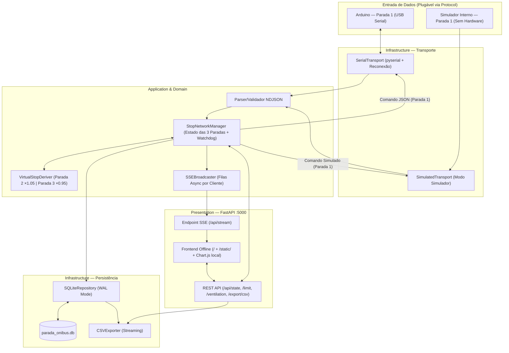
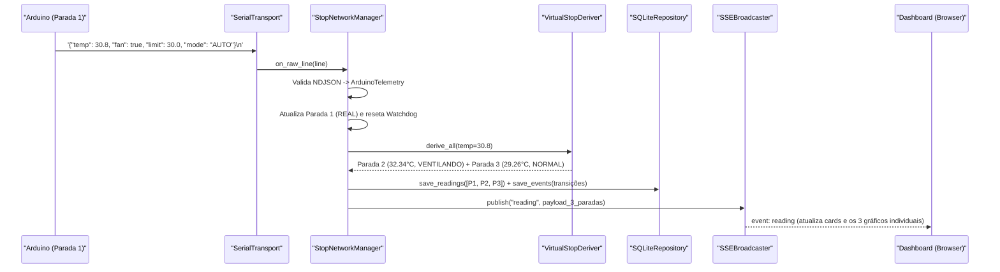
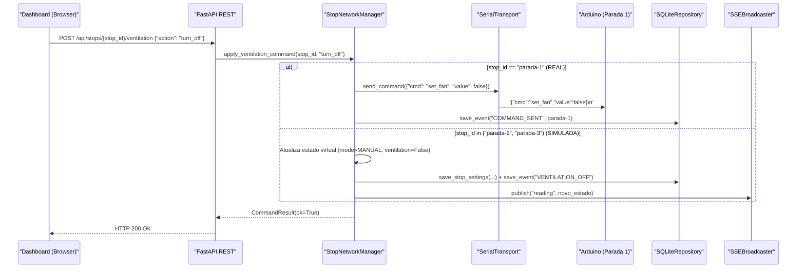

# TechSpec — Dashboard Central de Monitoramento e Controle de Paradas de Ônibus (Raspberry Pi)

**Demanda:** `abrigo-ventilacao-automatica`  
**Versão:** `1.0`  
**Status:** ✅ Aprovada (Formalmente aprovada pelo usuário — pronta para Tasks)  
**Referência:** [prd.md](./prd.md) (✅ Aprovado — v1.3)

---

## 1. Visão Arquitetural

### 1.1 Estilo Arquitetural
O sistema adotará uma **Arquitetura em Camadas com Inversão de Dependência (Ports & Adapters / Clean Architecture enxuta)** executando em um único processo Python leve e otimizado para a **Raspberry Pi**:

- **Domain (`domain/`):** Entidades imutáveis (`dataclasses`), `StrEnum`s, regras puras de derivação das paradas virtuais, avaliação da regra de ventilação (`temp >= limite`), validação de faixas e contratos (`Protocol`) sem dependência de frameworks ou hardware.
- **Application (`application/`):** Orquestração do estado das 3 paradas (`StopNetworkManager`), controle de watchdog de desconexão, despacho de comandos (Serial para Parada 1; memória para Paradas 2 e 3), registro de eventos e difusão em tempo real (`EventBroadcaster`).
- **Infrastructure (`infrastructure/`):**
  - **Transporte Serial (`SerialTransport`):** leitura/escrita NDJSON via `pyserial` em thread dedicada com reconexão automática.
  - **Transporte Simulado (`SimulatedTransport`):** gerador sintético da Parada 1 (oscilando ao redor de `30 °C`) implementando o mesmo `Protocol` do transporte real (RF-09).
  - **Persistência (`SQLiteRepository`):** armazenamento local em SQLite com modo WAL otimizado para cartão SD + gerador streaming de CSV.
  - **Configuração (`ConfigLoader`):** leitura via `config.toml` (`tomllib` stdlib) sobrescrita por variáveis de ambiente (RNF-06).
- **Presentation (`web/`):** Servidor HTTP assíncrono em **FastAPI + Uvicorn** expondo API REST, canal **SSE (`Server-Sent Events`)** e o frontend estático **100% offline** (HTML/CSS/JS puro + `Chart.js` empacotado localmente em `/static/vendor/`).

### 1.2 Stack Tecnológica (Python 3.12+)
| Camada | Tecnologia | Justificativa |
| --- | --- | --- |
| **Linguagem** | Python `3.12+` | Tipagem estrita (`type hints`), `dataclasses(slots=True)`, `StrEnum`, `tomllib` nativo. |
| **Servidor Web / API** | `FastAPI` + `Uvicorn` | Assíncrono nativo, leve para Raspberry Pi, ótimo suporte a SSE (`StreamingResponse`) e validação de payloads. |
| **Tempo Real (Push)** | `SSE (Server-Sent Events)` | Unidirecional sobre HTTP padrão, reconexão automática nativa via `EventSource` no navegador e menor sobrecarga que WebSocket. |
| **Comunicação Serial** | `pyserial` | Biblioteca madura e padrão para comunicação USB Serial (`/dev/ttyACM0`, `/dev/ttyUSB0`, `COMx`). |
| **Banco de Dados** | `sqlite3` (stdlib) | Zero infraestrutura extra, persistência confiável em arquivo local, modo `WAL` para baixo desgaste do cartão SD. |
| **Exportação CSV** | `csv` (stdlib) | Geração em streaming sem carregar grandes volumes na RAM da Raspberry Pi. |
| **Frontend & Gráficos** | HTML5 + CSS3 + JS ES6 + `Chart.js` local | Sem etapa de build complexa (zero Node.js na Raspi) e **100% funcional offline** na rede local da maquete. |
| **Testes & Qualidade** | `pytest`, `pytest-asyncio`, `httpx`, `ruff`, `mypy` | Testes unitários, de integração HTTP/SSE/SQLite e verificação estática de tipos. |

---

## 2. Diagramas de Arquitetura e Sequência

### 2.1 Arquitetura de Componentes



### 2.2 Fluxo de Telemetria Contínua e Derivação



### 2.3 Fluxo de Comando do Usuário (Alterar Limite / Desligar Ventilação)



---

## 3. Modelagem de Dados (`dataclasses` & Tipagem Estrita)

Todas as estruturas de domínio utilizam **Python 3.12+**, `StrEnum`, `type hints` completos e `@dataclass(frozen=True, slots=True)` para imutabilidade, clareza e baixo consumo de memória na Raspberry Pi.

```python
from dataclasses import dataclass
from datetime import datetime
from enum import StrEnum


class StopOrigin(StrEnum):
    REAL = "REAL"
    SIMULADA = "SIMULADA"


class ControlMode(StrEnum):
    AUTO = "AUTO"
    MANUAL = "MANUAL"


class StopStatus(StrEnum):
    NORMAL = "NORMAL"
    VENTILANDO = "VENTILANDO"
    DESCONECTADO = "DESCONECTADO"


class CommandType(StrEnum):
    SET_LIMIT = "set_limit"
    SET_FAN = "set_fan"
    SET_MODE = "set_mode"


class EventType(StrEnum):
    VENTILATION_ON = "VENTILATION_ON"
    VENTILATION_OFF = "VENTILATION_OFF"
    COMMAND_SENT = "COMMAND_SENT"
    LIMIT_CHANGED = "LIMIT_CHANGED"
    SERIAL_CONNECTED = "SERIAL_CONNECTED"
    SERIAL_DISCONNECTED = "SERIAL_DISCONNECTED"


@dataclass(frozen=True, slots=True)
class StopConfig:
    stop_id: str                 # ex.: "parada-1", "parada-2", "parada-3"
    name: str                    # ex.: "Parada 1 — Maquete (Av. Central)"
    origin: StopOrigin
    derivation_factor: float     # 1.00 para Real; ex.: 1.05 e 0.95 para Simuladas
    initial_limit: float = 30.0


@dataclass(frozen=True, slots=True)
class AppConfig:
    host: str = "0.0.0.0"
    port: int = 5000
    mode: str = "serial"         # "serial" | "simulator"
    serial_port: str = "/dev/ttyACM0"
    baud_rate: int = 9600
    serial_timeout_seconds: float = 6.0
    serial_reconnect_max_seconds: float = 5.0
    db_path: str = "data/parada_onibus.db"
    db_persist_interval_seconds: float = 1.0
    chart_history_points: int = 120
    simulator_interval_seconds: float = 1.0
    stops: tuple[StopConfig, ...] = ()


@dataclass(frozen=True, slots=True)
class ArduinoTelemetry:
    temp: float
    fan: bool
    limit: float | None = None
    mode: ControlMode | None = None
    received_at: datetime | None = None


@dataclass(frozen=True, slots=True)
class ArduinoCommand:
    cmd: CommandType
    value: float | bool | str


@dataclass(frozen=True, slots=True)
class StopReading:
    timestamp: datetime
    stop_id: str
    stop_name: str
    origin: StopOrigin
    temperature: float
    temp_limit: float
    ventilation: bool
    mode: ControlMode


@dataclass(frozen=True, slots=True)
class StopState:
    stop_id: str
    name: str
    origin: StopOrigin
    derivation_factor: float
    temperature: float | None
    temp_limit: float
    ventilation: bool
    mode: ControlMode
    status: StopStatus
    last_updated: datetime | None


@dataclass(frozen=True, slots=True)
class SystemEvent:
    timestamp: datetime
    stop_id: str
    event_type: EventType
    message: str
    payload_json: str | None = None


@dataclass(frozen=True, slots=True)
class NetworkSummary:
    connected: bool
    operation_mode: str          # "serial" | "simulator"
    average_temperature: float | None
    max_temperature: float | None
    ventilating_count: int
    total_stops: int
```

### 3.1 Regras de Domínio Críticas
1. **Derivação das Paradas Virtuais (RF-03):**
   - Ao chegar leitura válida `temp_real` da Parada 1, cada parada com `origin == SIMULADA` calcula `temp = round(temp_real * derivation_factor, 2)`.
   - Se `mode == AUTO`: `ventilation = temp >= temp_limit`.
   - Se `mode == MANUAL`: preserva o valor comandado manualmente (`False` quando o operador clicou em *Desligar Ventilação*).
2. **Mapeamento de Status e Paleta Visual:**
   - Sem conexão Serial / watchdog estourado → `DESCONECTADO` (**Amarelo/Cinza**).
   - Conectado e `ventilation == True` → `VENTILANDO` (**Azul/Vermelho**).
   - Conectado e `ventilation == False` → `NORMAL` (**Verde**).
3. **Pausa em Perda de Sinal (RF-08):**
   - Se a Parada 1 ficar mais de `serial_timeout_seconds` (padrão `6.0s`) sem enviar JSON válido, todas as 3 paradas passam para `status = DESCONECTADO`, **nenhuma leitura simulada nova é gerada ou gravada no SQLite** e um evento `SERIAL_DISCONNECTED` é publicado via SSE.

---

## 4. Interfaces, Contratos e APIs

### 4.1 Contrato Serial Bidirecional (NDJSON — Arduino ↔ Raspberry Pi)

> Este contrato será espelhado em um arquivo dedicado `docs/CONTRATO_SERIAL_ARDUINO.md` para entrega direta ao colega responsável pelo firmware do Arduino.

- **Camada física:** USB Serial (`8N1`), baud rate padrão **`9600 bps`** (configurável até `115200`), encoding `UTF-8`/ASCII.
- **Formato:** **NDJSON** — exatamente **1 objeto JSON por linha**, terminado por `\n`.

#### A) Telemetria: Arduino → Raspberry Pi (envio contínuo a cada ~1s)
```json
{"temp": 31.4, "fan": true, "limit": 30.0, "mode": "AUTO"}
```
| Campo | Tipo | Obrigatório | Regra de Validação |
| --- | --- | --- | --- |
| `temp` | `number` (`float`) | Sim | Número finito entre `-20.0` e `100.0` (°C). |
| `fan` | `boolean` | Sim | `true` (ventilação ligada) ou `false` (desligada). |
| `limit` | `number` (`float`) | Não | Se omitido, assume o último limite conhecido (padrão `30.0`). |
| `mode` | `string` | Não | `"AUTO"` ou `"MANUAL"`. Se omitido, assume `"AUTO"`. |

*(Mensagens de debug ou linhas corrompidas na inicialização do Arduino que não sejam JSON válido são descartadas com log `WARNING`, sem interromper o serviço.)*

#### B) Comandos: Raspberry Pi → Arduino (envio sob demanda via Dashboard)
1. **Alterar temperatura limite:**
   ```json
   {"cmd": "set_limit", "value": 28.5}
   ```
2. **Desligar ventilação (override manual no Arduino):**
   ```json
   {"cmd": "set_fan", "value": false}
   ```
3. **Retornar ao modo automático (Arduino retoma regra `temp >= limit`):**
   ```json
   {"cmd": "set_mode", "value": "AUTO"}
   ```

- **Confirmação (Ack):** Não exige protocolo complexo de handshake no Arduino; o próximo frame de telemetria (~1s) refletindo os novos `limit`/`fan`/`mode` confirma o estado real. Caso o colega deseje enviar `{"ack": "set_limit", "ok": true}`, o parser reconhecerá e registrará o log sem tratá-lo como erro.

---

### 4.2 Esquema do Banco de Dados SQLite

Pragmas aplicados na abertura da conexão (RNF-01 / RNF-03):
```sql
PRAGMA journal_mode = WAL;
PRAGMA synchronous = NORMAL;
PRAGMA foreign_keys = ON;
PRAGMA busy_timeout = 5000;
```

```sql
CREATE TABLE IF NOT EXISTS readings (
    id          INTEGER PRIMARY KEY AUTOINCREMENT,
    timestamp   TEXT    NOT NULL, -- ISO-8601 UTC (ex.: 2026-11-22T21:00:00+00:00)
    stop_id     TEXT    NOT NULL,
    stop_name   TEXT    NOT NULL,
    origin      TEXT    NOT NULL, -- 'REAL' | 'SIMULADA'
    temperature REAL    NOT NULL,
    temp_limit  REAL    NOT NULL,
    ventilation INTEGER NOT NULL, -- 0 | 1
    mode        TEXT    NOT NULL  -- 'AUTO' | 'MANUAL'
);

CREATE INDEX IF NOT EXISTS idx_readings_stop_ts ON readings (stop_id, timestamp DESC);
CREATE INDEX IF NOT EXISTS idx_readings_ts      ON readings (timestamp DESC);

CREATE TABLE IF NOT EXISTS events (
    id           INTEGER PRIMARY KEY AUTOINCREMENT,
    timestamp    TEXT NOT NULL,
    stop_id      TEXT NOT NULL,
    event_type   TEXT NOT NULL,
    message      TEXT NOT NULL,
    payload_json TEXT
);

CREATE INDEX IF NOT EXISTS idx_events_ts ON events (timestamp DESC);

CREATE TABLE IF NOT EXISTS stop_settings (
    stop_id    TEXT PRIMARY KEY,
    temp_limit REAL    NOT NULL,
    mode       TEXT    NOT NULL,
    manual_fan INTEGER NOT NULL DEFAULT 0,
    updated_at TEXT    NOT NULL
);
```

- **Persistência pós-reinicialização (RF-06):** `stop_settings` preserva limites e modos alterados entre reinícios; `readings` e `events` mantêm o histórico completo para gráficos e exportação CSV.
- **Proteção do Cartão SD (RNF-01):** leituras contínuas são gravadas em uma única transação agrupando as 3 paradas por ciclo (1 commit por ciclo configurável via `db_persist_interval_seconds`, padrão `1.0s`), evitando 3 commits separados por segundo.

---

### 4.3 API HTTP REST + SSE (`0.0.0.0:5000`)

| Método | Endpoint | Descrição | Payload / Query | Resposta |
| --- | --- | --- | --- | --- |
| `GET` | `/` | Serve a Dashboard Web (`index.html`). | — | `text/html` |
| `GET` | `/static/{path}` | Assets estáticos offline (`styles.css`, `app.js`, `vendor/chart.umd.min.js`). | — | Estático |
| `GET` | `/api/health` | Status de saúde, modo de operação e conexão Serial. | — | `200 OK` JSON |
| `GET` | `/api/state` | Snapshot completo: resumo da rede, estado das 3 paradas e histórico inicial (até `chart_history_points`) para renderizar imediatamente os 3 gráficos individuais e o comparativo. | — | `200 OK` JSON |
| `GET` | `/api/stops/{stop_id}/readings` | Histórico de leituras de uma parada específica. | `?limit=120` (`1..2000`) | `200 OK` JSON |
| `GET` | `/api/events` | Feed de eventos recentes (acionamentos, comandos, conexão). | `?limit=50` (`1..500`) | `200 OK` JSON |
| `POST` | `/api/stops/{stop_id}/limit` | Altera a temperatura limite de uma parada (`15.0` a `50.0 °C`). | `{"limit": 28.5}` | `200 OK` / `400` / `404` / `503` (se Parada 1 desconectada) |
| `POST` | `/api/stops/{stop_id}/ventilation` | Controla ventilação: desliga em override manual ou retorna ao automático. | `{"action": "turn_off"}` ou `{"action": "auto"}` | `200 OK` / `400` / `404` / `503` |
| `GET` | `/api/export/csv` | Download de arquivo `.csv` estruturado (todas as paradas ou filtrada). | `?stop_id=parada-1` (opcional) | `200 OK` `text/csv` (streaming) |
| `GET` | `/api/stream` | Canal **SSE** em tempo real. | — | `text/event-stream` |

#### Formato do CSV Exportado (RF-07)
- Cabeçalho exato: `timestamp,parada_id,nome,origem,temperatura,limite,ventilacao,modo`
- `Content-Disposition: attachment; filename="paradas_onibus_YYYYMMDD_HHMMSS.csv"` (ou `parada-1_YYYYMMDD_HHMMSS.csv` quando filtrado).

#### Eventos SSE (`/api/stream`)
- `event: snapshot` — enviado imediatamente ao conectar o cliente.
- `event: reading` — enviado a cada ciclo válido contendo o resumo da rede + os 3 estados/leituras atualizados.
- `event: status` — enviado quando a conexão Serial muda (`CONNECTED` / `DISCONNECTED`).
- `event: event_log` — enviado quando ocorre transição de ventilação ou comando de controle.
- Comentário keep-alive `: ping\n\n` a cada `15s` para manter a conexão ativa em celulares na rede local.

---

### 4.4 Interface Web (Dashboard Offline-First)
1. **Barra Superior & Resumo Consolidado:**
   - Indicador de conexão Serial (`CONECTADO`, `DESCONECTADO`, `MODO SIMULADOR`), temperatura média, temperatura máxima, paradas ventilando (`X / 3`) e botões de **Exportar CSV** (Todas / Parada 1 / Parada 2 / Parada 3).
2. **Grid Principal — 3 Cards de Paradas (lado a lado em desktop, empilhados em mobile):**
   - Título da parada + badge de origem (`REAL · ARDUINO` ou `SIMULADA · ×1.05` / `×0.95`).
   - Indicador visual de estado com paleta de cores: **Verde** (`NORMAL`), **Azul/Vermelho** (`VENTILANDO`), **Amarelo/Cinza** (`DESCONECTADO`).
   - Temperatura atual em destaque (°C), limite ativo (°C) e modo (`AUTOMÁTICO` / `MANUAL`).
   - **Gráfico individual `Chart.js` visível por padrão dentro de cada card:** curva de variação da temperatura no tempo + linha horizontal tracejada indicando o limite configurado daquela parada.
   - Controles individuais: campo numérico + botão **Alterar Limite** e botão **Desligar Ventilação** (override manual) / **Voltar ao Automático**.
3. **Painel Analítico Complementar:**
   - Gráfico comparativo sobrepondo a temperatura das 3 paradas no mesmo eixo temporal.
   - Lista de eventos recentes (timestamp, parada, tipo e descrição).

---

## 5. Estrutura de Diretórios Proposta

```text
projeto-parada-onibus/
├── pyproject.toml                       # Dependências, Python >=3.12, config ruff/mypy/pytest
├── config.example.toml                  # Exemplo completo de configuração externa (RNF-06)
├── docs/
│   └── CONTRATO_SERIAL_ARDUINO.md       # Spec enxuta do JSON Serial para o colega do Arduino
├── src/
│   └── parada_onibus/
│       ├── __init__.py
│       ├── __main__.py                  # Entrypoint: python -m parada_onibus [--simulator]
│       ├── domain/
│       │   ├── __init__.py
│       │   ├── models.py                # StrEnums e dataclasses (StopState, StopReading, etc.)
│       │   ├── ports.py                 # Protocols (TelemetryTransport, DataRepository)
│       │   ├── parser.py                # Parser/validador NDJSON e serializador de comandos
│       │   └── deriver.py               # Regra de derivação das Paradas 2 e 3 + avaliação auto/manual
│       ├── application/
│       │   ├── __init__.py
│       │   ├── broadcaster.py           # SSEBroadcaster (pub/sub assíncrono com backpressure)
│       │   └── manager.py               # StopNetworkManager (orquestração, watchdog, comandos)
│       ├── infrastructure/
│       │   ├── __init__.py
│       │   ├── config.py                # Loader config.toml + variáveis de ambiente
│       │   ├── serial_transport.py      # SerialTransport (pyserial em thread + reconexão)
│       │   ├── simulator_transport.py   # SimulatedTransport (onda térmica cruzando 30°C + comandos)
│       │   ├── sqlite_repository.py     # Persistência SQLite (WAL) + consultas
│       │   └── csv_exporter.py          # Streaming CSV (geral e filtrado por parada)
│       └── web/
│           ├── __init__.py
│           ├── app.py                   # Factory FastAPI + lifespan (startup/shutdown limpo)
│           ├── routes.py                # Rotas REST, CSV e SSE (/api/*)
│           └── static/
│               ├── index.html           # Dashboard responsiva das 3 paradas
│               ├── styles.css           # Tema, responsividade e paleta de estados
│               ├── app.js               # EventSource (SSE), controles REST e Chart.js
│               └── vendor/
│                   └── chart.umd.min.js # Chart.js empacotado localmente (100% offline)
└── tests/
    ├── conftest.py
    ├── unit/
    │   ├── test_parser.py
    │   ├── test_deriver.py
    │   └── test_config.py
    └── integration/
        ├── test_sqlite_repository.py
        ├── test_api_and_sse.py
        └── test_simulator_e2e.py
```

---

## 6. Tratamento de Erros, Resiliência e Observabilidade

| Cenário de Falha | Estratégia de Mitigação |
| --- | --- |
| **JSON malformado / linha parcial no boot do Arduino** | `parser.py` captura `JSONDecodeError`, valida tipos/faixas finitas (`math.isfinite`), descarta a linha e registra `WARNING` sem quebrar o loop Serial. |
| **Cabo USB desconectado / Arduino reiniciado** | `SerialTransport` captura `SerialException`/`OSError`, fecha a porta com segurança, notifica `on_disconnect` e tenta reconectar com backoff exponencial (`1s → 2s → 5s`). |
| **Arduino travado (porta aberta, mas sem dados)** | Watchdog assíncrono no `StopNetworkManager` verifica periodicamente `now - last_seen > serial_timeout_seconds` (`6.0s`), marca `DESCONECTADO`, pausa derivações virtuais e publica evento SSE `status`. |
| **Comando enviado à Parada 1 com Arduino offline** | Endpoint retorna `HTTP 503 Service Unavailable` com mensagem clara no dashboard (evitando falsa sensação de comando aplicado no hardware). |
| **Cliente SSE lento ou desconectado** | Cada cliente SSE possui uma `asyncio.Queue(maxsize=32)`; se encher, descarta o item mais antigo para impedir vazamento de memória na Raspberry Pi. |
| **Encerramento do processo (`SIGINT`/`SIGTERM`)** | `lifespan` do FastAPI encerra o transporte Serial/Simulador, sinaliza encerramento às filas SSE e fecha a conexão SQLite de forma limpa. |
| **Observabilidade** | Logs estruturados via `logging` (nível configurável via `LOG_LEVEL`, padrão `INFO`) com timestamp, componente e contexto de erro. |

---

## 7. Estratégia de Testes

1. **Testes Unitários (`tests/unit/`):**
   - `test_parser.py`: telemetria válida completa/parcial, JSON corrompido, `NaN`/`Infinity`, temperatura fora da faixa, serialização dos 3 comandos (`set_limit`, `set_fan`, `set_mode`).
   - `test_deriver.py`: cálculo com fatores `1.05` e `0.95`, ativação/desativação em `30 °C`, override manual (`turn_off`), retorno ao modo `AUTO` e isolamento entre limites individuais das 3 paradas.
   - `test_config.py`: valores padrão, leitura de `config.toml` e sobrescrita por variáveis de ambiente.
2. **Testes de Integração (`tests/integration/`):**
   - `test_sqlite_repository.py`: inserção em lote das 3 paradas, consulta de histórico ordenado, persistência de `stop_settings` entre reinicializações de instância e validação do conteúdo CSV (geral e filtrado por parada).
   - `test_api_and_sse.py`: endpoints REST (`/api/health`, `/api/state`, `/api/stops/{id}/limit`, `/api/stops/{id}/ventilation`, `/api/export/csv`), validações `400`/`404`/`503` e recepção de eventos no stream SSE.
   - `test_simulator_e2e.py`: execução ponta a ponta sem hardware usando `SimulatedTransport` acelerado, validando cruzamento de `30 °C`, derivação nas Paradas 2 e 3, acionamento de eventos e exportação CSV.
3. **Verificação Estática (CI local):**
   - `mypy src` (tipagem estrita) e `ruff check src tests` (lint/formatação) antes de concluir a entrega.
