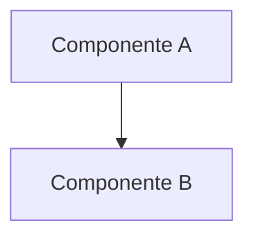

# TechSpec — abrigo-ventilacao-automatica

> **Status:** ⏳ Aguardando aprovação formal do `prd.md`.

## 1. Visão Arquitetural
- **Estilo Arquitetural:**
- **Stack Tecnológica (Python 3.12+):**

## 2. Diagramas de Arquitetura e Sequência


## 3. Modelagem de Dados (`dataclasses` & Tipagem Estrita)
- Entidades, DTOs e contratos de mensagens.

## 4. Interfaces, Contratos e APIs
- Protocolos externos, endpoints HTTP/WebSocket, formatos de payload.

## 5. Estrutura de Diretórios Proposta
```text
src/
tests/
```

## 6. Tratamento de Erros, Resiliência e Observabilidade
- Estratégias de reconexão, logs e validação.

## 7. Estratégia de Testes
- Unitários, integração e simulação.
